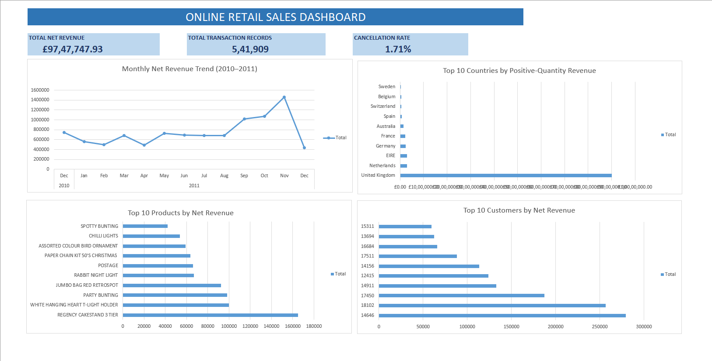

Retail Sales & Customer Behaviour Analysis

Project Overview

This project analyzes 541,909 real-world online retail transaction records to understand sales performance, customer purchasing behaviour, product performance, cancellations, and data quality.

The project aims to demonstrate practical data analytics skills using Microsoft Excel, with future analysis planned using MySQL, Python, Power BI, and Tableau.

Dataset

Source: UCI Online Retail Dataset

Records: 541,909

Period: December 2010 – December 2011

Industry: Online Retail

Tools & Technologies

Microsoft Excel: Data exploration, cleaning, formulas, PivotTables, PivotCharts, and dashboard creation

Git & GitHub: Version control and project documentation

MySQL: SQL-based business analysis (planned)

Python: Data cleaning and exploratory analysis (planned)

Power BI: Interactive dashboard development (planned)

Tableau: Data visualization (planned)

Excel Analysis — Completed

The Excel analysis covers:

Transaction classification and cancellation analysis

Missing-data investigation

Geographic revenue analysis

Top 10 product descriptions by revenue

Monthly revenue trends

Top 10 customers by net revenue

Excel dashboard with four charts and three KPI indicators

Key Business Insights

1. Revenue Performance

Total recorded net revenue: £9,747,747.93

Total transaction records: 541,909

2. Monthly Sales Analysis

Highest-revenue month: November 2011

November 2011 revenue: approximately £1.46 million

December 2011 is an incomplete month, so comparisons with full months require caution.

3. Geographic Revenue Analysis

The United Kingdom generated approximately £9 million in positive-quantity revenue.

The UK accounted for approximately 84.58% of total positive-quantity revenue.

4. Customer Analysis

Highest-revenue customer: CustomerID 14646

Customer net revenue: approximately £279,489

Missing CustomerIDs were excluded from customer rankings.

5. Cancellation Analysis

Cancellation records: 9,288

Cancellation record rate: 1.71%

Recorded cancellation revenue: approximately -£896,812

The cancellation rate is calculated at the transaction-line level, not the unique-order level.

6. Data Quality Findings

Missing CustomerIDs: 135,080 (24.93%)

Missing product descriptions: 1,454 (0.27%)

All records with missing descriptions had a unit price of zero.

Excel Dashboard : 

Created an Excel dashboard featuring:

Monthly Net Revenue Trend

Top 10 Countries by Revenue

Top 10 Product Descriptions by Revenue

Top 10 Customers by Net Revenue

Key Performance Indicators:

Total Net Revenue

Total Transaction Records

Cancellation Rate

The completed Excel workbook is available at:

excel/online_retail_analysis.xlsx

Methodology note: Overall net revenue includes recorded cancellations and adjustments. The geographic analysis uses positive-quantity revenue, so these figures have different calculation bases.

Project Status

Excel Analysis: Completed

Upcoming Work:

MySQL business analysis

Python-based exploratory analysis

Power BI dashboard

Tableau visualizations

Additional business recommendations

Project Objective

To build a practical, end-to-end data analytics portfolio demonstrating data cleaning, validation, analysis, visualization, and business insight generation using real-world retail data.