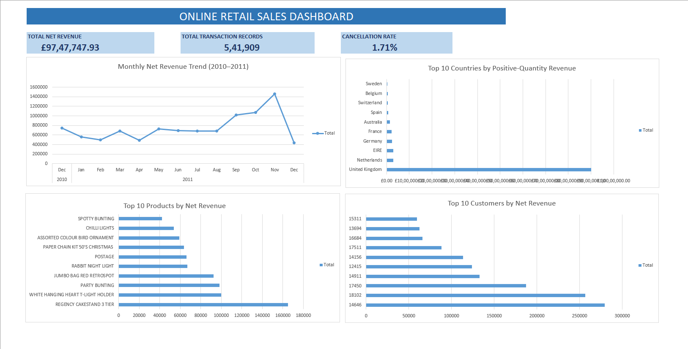

Retail Sales & Customer Behaviour Analysis

Project Overview

This project analyzes 541,909 real-world online retail transaction records to understand sales performance, customer purchasing behaviour, product performance, cancellations, and data quality.

The objective is to demonstrate an end-to-end data analytics workflow, from data exploration and cleaning to SQL analysis, Python-based exploration, interactive dashboards, and business insight generation.

Dataset

Source: [UCI Online Retail Dataset](https://archive.ics.uci.edu/dataset/352/online+retail)
Records: 541,909
Period: December 2010 – December 2011
Industry: Online Retail

Tools & Technologies

| Tool | Purpose |
|---|---|
| Microsoft Excel | Data exploration, cleaning, formulas, PivotTables, PivotCharts and dashboard creation |
| MySQL | SQL queries and business analysis |
| Python | Data cleaning and exploratory data analysis |
| Power BI | Interactive dashboard development and visualization |
| Git & GitHub | Version control and project documentation |
| Tableau | Planned future visualization work |

---

Project Work

1. Excel Analysis — Completed

The Excel analysis covers:

- Transaction classification and cancellation analysis
- Missing-data investigation
- Geographic revenue analysis
- Top 10 product descriptions by revenue
- Monthly revenue trends
- Top 10 customers by net revenue
- Interactive-style Excel dashboard with charts and KPI indicators

Excel Dashboard



Workbook: `excel/online_retail_analysis.xlsx`

2. MySQL Analysis — Completed

SQL-based business analysis covering:

- Revenue calculations
- Country-wise sales performance
- Top customers by revenue
- Product performance
- Monthly sales analysis
- Business-focused SQL queries

SQL project: `sql/`

3. Python Analysis — Completed

Python was used for data cleaning and exploratory analysis, including:

- Data inspection and validation
- Revenue calculations
- Customer-level analysis
- Descriptive statistics
- Exploratory data analysis

Python project: `python/`

4. Power BI Dashboard — Completed

An interactive Power BI dashboard was developed to visualize retail sales performance.

Dashboard Features

- Total Net Revenue
- Positive Sales
- Total Orders
- Total Customers
- Monthly Revenue Trend
- Top 10 Countries by Revenue
- Top 10 Products by Revenue
- Top 10 Customers by Revenue
- Country slicer
- Date-range slicer

Power BI file: `powerbi/retail_sales_dashboard.pbix`

---

Key Business Insights

1. Revenue Performance

- Total recorded net revenue: £9,747,747.93
- Total transaction records: 541,909

2. Monthly Sales Analysis

- Highest-revenue month: November 2011
- November 2011 revenue: approximately £1.46 million
- December 2011 is an incomplete month, so comparisons with full months require caution.

3. Geographic Revenue Analysis

- The United Kingdom generated approximately £9 million in positive-quantity revenue.
- The UK accounted for approximately 84.58% of total positive-quantity revenue.

4. Customer Analysis

- Highest-revenue customer: CustomerID 14646
- Missing CustomerIDs were excluded from customer rankings.

5. Cancellation Analysis

- Cancellation records: 9,288
- Cancellation record rate: 1.71%
- Recorded cancellation revenue: approximately -£896,812
- The cancellation rate is calculated at the transaction-line level, not the unique-order level.

6. Data Quality Findings

- Missing CustomerIDs: 135,080 (24.93%)
- Missing product descriptions: 1,454 (0.27%)
- All records with missing descriptions had a unit price of zero.

---

Methodology Notes

- Overall net revenue includes recorded cancellations and adjustments.
- Geographic analysis uses positive-quantity revenue, excluding cancellation lines.
- These figures therefore have different calculation bases.
- Missing CustomerIDs are excluded from customer-level rankings.
- The cancellation rate is based on transaction lines rather than unique invoices.

Repository Structure

```text
retail-sales-analytics/
│
├── excel/
│   ├── online_retail_analysis.xlsx
│   └── excel-analysis.md
│
├── sql/
│   └── retail_analysis.sql
│
├── python/
│   └── Python analysis files
│
├── powerbi/
│   └── retail_sales_dashboard.pbix
│
├── images/
│   └── sales_dashboard.png
│
└── README.md
```

Project Status

| Component | Status |
|---|---|
| Excel Analysis | Completed |
| MySQL Analysis | Completed |
| Python Analysis | Completed |
| Power BI Dashboard | Completed |
| Tableau | Planned |
| Documentation | Finalizing |

Project Objective

To build a practical, end-to-end data analytics portfolio demonstrating data cleaning, validation, SQL querying, exploratory analysis, data visualization, and business insight generation using a real-world retail dataset.